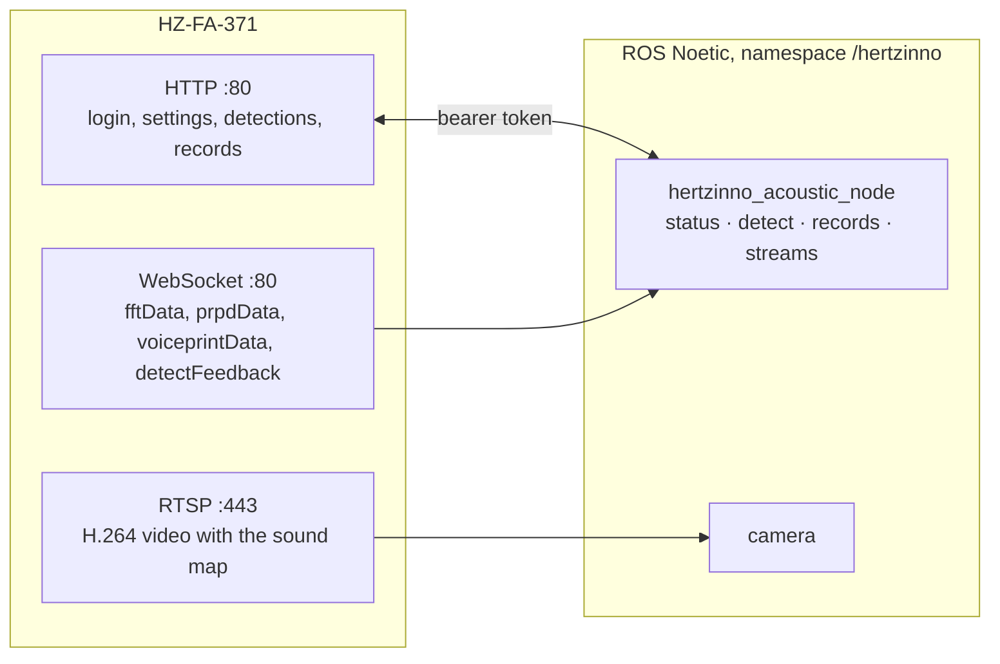

<div align="center">

# hertzinno_acoustic_driver

**ROS Noetic driver for the Hertzinno HZ-FA-371 online acoustic camera: start a partial
discharge or gas leak detection, get its result (type, intensity, leak rate, photos) when it is
really done, change every setting, read the camera's records and see the sound map video. Built
for substation inspection on a Deep Robotics X30.**

[](https://github.com/DarmawanRobotics/hertzinno_acoustic_driver/actions/workflows/ci.yml)
[](https://wiki.ros.org/noetic)
[](https://releases.ubuntu.com/20.04/)


[](LICENSE)

[Interface](#interface) · [Is the detection done?](#is-the-detection-done) · [Network](#network) ·
[Quick start](#quick-start) · [Usage](#usage) · [Inspection loop](#inspection-loop) ·
[Parameters](#parameters) · [Verify on the real camera](#verify-on-the-real-camera) ·
[Develop](#develop)

</div>

---

The HZ-FA-371 images sound with 128 MEMS microphones (2–65 kHz) over a 1080p camera and
classifies what it hears: **partial discharge** (corona, surface, floating) or **gas leaks**
(with the leak rate). Everything goes over its Ethernet port, as described in *Online Acoustic
Camera User Manual And API* V5.1: an **HTTP** API with token login for settings, detections and
records, **WebSocket** streams for the spectrum and the results, and **RTSP** for the video. The
camera client (namespace `hertzinno`) has no ROS dependency; the ROS layer is split into status
and settings, detections, and streams.



## Interface

All names under the launch namespace (`/hertzinno` by default).

**Action** (`actionlib`)

| Action | Type | |
|---|---|---|
| `detect` | `Detect` | one detection: **succeeds only with the result of a measurement that began after the goal**; photos on request; feedback = elapsed time |

**Topics**

| Topic | Type | |
|---|---|---|
| `status` | `hertzinno_acoustic_driver/AcousticStatus` | connected, detecting, mode, band, threshold, detection time, streams (`status_rate`, 1 Hz) |
| `detection` | `hertzinno_acoustic_driver/DetectionResult` | every result the camera reports: type, intensity, probabilities, leak rate and cost, files |
| `spectrum` | `hertzinno_acoustic_driver/Spectrum` | FFT, 512 bins, 5 Hz, with the peak inside the analysis band |
| `prpd`, `voiceprint` | `hertzinno_acoustic_driver/RawFrame` | PRPD and voiceprint frames as received, 1 Hz (layout not in the manual) |
| `camera/image_raw` | `sensor_msgs/Image` | the RTSP video: visible image with the sound map drawn on it |
| `camera/image_raw/compressed` | `sensor_msgs/CompressedImage` | via image_transport |

**Services**

| Service | Type | |
|---|---|---|
| `get_config` | `GetConfig` | detection settings, video, detection area, leak estimation (leakage mode) |
| `set_threshold` | `SetValue` | imaging threshold, 0..100 dB |
| `set_band` | `SetBand` | analysis band in kHz, 2–20 kHz wide, up to half the sample rate |
| `set_duration` | `SetValue` | detection time, s |
| `set_video` | `SetVideo` | resolution, fps, bit rate, RTSP port (0 keeps a setting) |
| `set_detection_area` | `SetDetectionArea` | report only sources inside a box of the video |
| `set_leakage` | `SetLeakage` | one leak estimation setting: distance, units, currency, gas value, energy cost, ... |
| `start_detection`, `stop_detection` | `std_srvs/Trigger` | continuous monitoring; results on `detection` |
| `get_logs` | `GetLogs` | the camera's records (the latest 100), filtered by time and type |
| `get_file` | `GetFile` | a photo or video of a record, returned or saved to a folder |
| `delete_logs` | `DeleteLogs` | delete records |
| `http_request` | `RawRequest` | any other HTTP call, with the token |

Result types: partial discharge `noise`, `corona`, `surface`, `floating`; leakage `no_leak`,
`leak`. `abnormal` is true for a discharge or a leak.

## Is the detection done?

`turn_on_detect` only starts a detection; the result comes later on the `detectFeedback`
WebSocket. `detect` therefore starts it and waits for the result:

| Result `state` | When |
|---|---|
| `detected` | a result arrived **at least one detection time after the start** (one second of timestamp resolution allowed): it measured what is in front of the camera now |
| `no_result` | the camera stopped detecting and no result followed within `result_grace` |
| `timeout` | nothing within `timeout` (default: detection time + `detect_timeout_margin`) |
| `preempted` | the goal was cancelled; the detection is stopped |
| `error` | the camera refused (the message has its reason) |

A detection that is already running (continuous monitoring) is stopped and started again
first, so a result measured while the robot was still moving is never taken. Without live
feedback the camera's records tell the result. Afterwards the detection is stopped unless
`keep_running` is set.

## Network

| | |
|---|---|
| camera IP | `192.168.2.204` (factory default, on the label); `host:=` in the launch |
| login | user `admin`, factory password `123456` |
| HTTP, WebSocket | `80` (`port:=`, `ws_port`) |
| RTSP | `443` (`video_port`, `rtsp_port:=`); the path is found automatically |

The camera sits in `192.168.2.x`; give the robot computer an address there (e.g.
`sudo ip addr add 192.168.2.10/24 dev eth0`) or change the camera's IP on its web page. Check the
login before launching:

```bash
curl -s -X POST -H 'Content-Type: application/json' http://192.168.2.204/login \
  -d "{\"username\": \"admin\", \"password\": \"$(echo -n '123456lfxs' | md5sum | cut -d' ' -f1)\"}"
# {"token": "..."}   (the password field is md5(password + "lfxs"))
```

## Quick start

Ubuntu 20.04, ROS Noetic (the X30's computer). Noetic is end-of-life, so `rosdep` needs
`--include-eol-distros`.

```bash
# 1. Source and dependencies
mkdir -p ~/catkin_ws/src && cd ~/catkin_ws/src
git clone https://github.com/DarmawanRobotics/hertzinno_acoustic_driver.git
cd ~/catkin_ws
rosdep update --rosdistro noetic --include-eol-distros
rosdep install --from-paths src --ignore-src -y --rosdistro noetic

# 2. Build
catkin_make && source devel/setup.bash      # or: catkin build

# 3. Launch (the password comes from the environment, so roslaunch never prints it)
export HERTZINNO_PASSWORD='<camera password>'
roslaunch hertzinno_acoustic_driver hertzinno.launch host:=192.168.2.204
#   camera:=false without the video

# 4. Second terminal
rostopic echo -n 1 /hertzinno/status
rosrun rqt_image_view rqt_image_view /hertzinno/camera/image_raw
```

## Usage

**One detection, with its result**

```bash
rosrun actionlib_tools axclient.py /hertzinno/detect               # GUI
rostopic pub -1 /hertzinno/detect/goal hertzinno_acoustic_driver/DetectActionGoal \
  "{goal: {duration: 3, fetch_photos: true}}"
rostopic echo -n 1 /hertzinno/detect/result      # state: "detected", result: {type: "surface", ...}
```

**Settings**

```bash
rosservice call /hertzinno/get_config
rosservice call /hertzinno/set_band "{freq_down_limit: 20, freq_up_limit: 40}"   # kHz
rosservice call /hertzinno/set_threshold "value: 10"                              # dB
rosservice call /hertzinno/set_duration "value: 3"                                # s
rosservice call /hertzinno/set_detection_area "{enabled: true, x: 640, y: 300, width: 640, height: 480}"
rosservice call /hertzinno/set_leakage "{field: leakage_distance, value: 1}"      # leakage mode
```

Settings can also be applied on every connection from [config/hertzinno.yaml](config/hertzinno.yaml)
(`db_limit`, `freq_down_limit`, `freq_up_limit`, `detect_times`). The work mode (partial discharge
or leakage) is set on the camera; `status` shows it.

**Continuous monitoring**

```bash
rosservice call /hertzinno/start_detection
rostopic echo /hertzinno/detection               # a result after every detection
rosservice call /hertzinno/stop_detection
```

**Records and files**

```bash
rosservice call /hertzinno/get_logs "{count: 10}"                     # newest records
rosservice call /hertzinno/get_logs "{types: 14}"                     # corona + surface + floating
rosservice call /hertzinno/get_file "{saving_path: '2024_02_01_11_38_20_133/', \
  file_name: 'sound_2024_02_01_11_38_20_133.jpg', save_to: '~/inspection'}"
rosservice call /hertzinno/delete_logs "ids: [14324, 14325]"
```

**Spectrum**

```bash
rostopic echo /hertzinno/spectrum/band_peak_hz   # where the band is loudest
rostopic echo -n 1 --noarr /hertzinno/spectrum
```

## Inspection loop

```python
#!/usr/bin/env python3
import os

import actionlib
import rospy
from hertzinno_acoustic_driver.msg import DetectAction, DetectGoal
from hertzinno_acoustic_driver.srv import SetBand

POINTS = ['trafo 1 bushing', 'breaker 3 clamp']   # where the robot stops
OUT = os.path.expanduser('~/inspection')

rospy.init_node('acoustic_inspection')
os.makedirs(OUT, exist_ok=True)
detect = actionlib.SimpleActionClient('/hertzinno/detect', DetectAction)
detect.wait_for_server()
rospy.ServiceProxy('/hertzinno/set_band', SetBand)(freq_down_limit=20, freq_up_limit=40)

for name in POINTS:
    # ... drive there and point the camera at the equipment; wait until the robot is still ...
    detect.send_goal_and_wait(DetectGoal(duration=3.0, fetch_photos=True))
    r = detect.get_result()
    if not r.success:
        rospy.logwarn('%s: %s %s', name, r.state, r.message)
        continue
    d = r.result
    rospy.loginfo('%s: %s, intensity %d', name, d.type, d.intensity)
    if d.abnormal and r.soundmap_photo.data:
        with open(os.path.join(OUT, name.replace(' ', '_') + '.jpg'), 'wb') as f:
            f.write(r.soundmap_photo.data)
```

## Parameters

[config/hertzinno.yaml](config/hertzinno.yaml) and [config/camera.yaml](config/camera.yaml), every
one commented.

**`hertzinno_acoustic_node`**

| Parameter | Default | |
|---|---|---|
| `host`, `port`, `user` | `192.168.2.204`, `80`, `admin` | from the launch |
| `password` | — | empty: `$HERTZINNO_PASSWORD` (`password_env`), then the factory default |
| `timeout`, `file_timeout` | `3.0`, `30.0` | s |
| `status_rate`, `config_period` | `1.0`, `10.0` | Hz, s |
| `db_limit`, `freq_down_limit`, `freq_up_limit`, `detect_times` | `-1` | applied on every connection, -1 keeps the camera's |
| `ws_port`, `heartbeat_sec` | `0`, `20.0` | 0: same as `port`; the camera drops clients silent for a minute |
| `streams/feedback`, `streams/fft`, `streams/prpd`, `streams/voiceprint` | `true` | WebSocket streams to open |
| `detect_timeout_margin`, `result_grace`, `photo_wait` | `15.0`, `5.0`, `8.0` | s |
| `frame_id` | `hertzinno_acoustic_optical_frame` | |

**`hertzinno_camera_node`** (`camera/camera`)

| Parameter | Default | |
|---|---|---|
| `rtsp_port`, `path` | `443`, `auto` | `auto` asks `probe_paths` with DESCRIBE every `probe_period` s until one answers; `url` overrides all |
| `codec`, `decoder` | `h264`, `auto` | `auto` = Jetson hardware → GStreamer software → FFmpeg |
| `latency_ms`, `protocols` | `0`, `tcp` | |
| `reconnect_sec`, `timeout_ms` | `1.0`, `5000` | back-off doubles to 30 s |
| `encoding`, `max_fps`, `width`, `height` | `bgr8`, `0`, `0`, `0` | |

## Verify on the real camera

The driver follows the manual and is tested against a simulated camera; these are the points the
manual leaves open.

1. **Login:** `status` shows `connected: True` and the log the mode, band and detection time.
2. **Video:** the camera node logs `RTSP path /<path>`. If no path answers, take it from the
   vendor and set `path` in [config/camera.yaml](config/camera.yaml).
3. **Detection:** `detect` with `duration: 3` ends `detected` and its type and intensity match the
   camera's web page (*Data view*). `no_result` or `timeout` means the camera signals the end of a
   detection differently; the log of the node shows what arrived.
4. **Photos:** `soundmap_photo` arrives with the result; raise `photo_wait` if the camera writes
   it later.
5. **Spectrum:** `band_peak_hz` follows a known ultrasonic source (a leak, a test emitter). If it
   does not, the 16-bit values may be big-endian or unsigned.
6. **PRPD / voiceprint:** note `data` length of `prpd` and `voiceprint`: with it the frames can
   be decoded into images.
7. **Detection area:** the box of `set_detection_area` appears where expected on the web page
   (video pixels).
8. **Streams:** all `*_stream` fields of `status` are true. If they stay false, try
   `heartbeat_sec` and `ws_port`; the camera may want them on another port.

## Develop

```bash
catkin_make run_tests && catkin_test_results build/test_results --verbose
bash src/hertzinno_acoustic_driver/test/smoke_test.sh     # with the workspace sourced
```

- `test_crypto`, `test_api`: the login hash and every message of the manual
- `test_websocket`: RFC 6455 frames, and the client against a scripted server
- `test_detection`: which result belongs to a detection, the FFT helpers
- `test_device_fake`: the client end to end against [test/fake_device.py](test/fake_device.py)
  (token login and renewal, settings, detections with feedback, records, files, streams)
- `test_rtsp`: pipelines, decoders, the capture loop, RTSP path discovery (Basic, Digest)
- `smoke_test.sh`: `hertzinno.launch` against the fake camera — action, services, topics; CI runs
  all of it in a `ros:noetic` container

```
hertzinno_acoustic_driver/
├── include/hertzinno_acoustic_driver/
│   ├── device.hpp            AcousticCamera: the HTTP API (no ROS)
│   ├── websocket.hpp         WebSocket client and stream thread (no ROS)
│   ├── api.hpp               JSON messages, limits, names (no ROS)
│   ├── detection.hpp         result timing, FFT helpers (no ROS)
│   ├── rtsp_probe.hpp        RTSP path discovery (no ROS)
│   ├── rtsp_capture.hpp      RTSP capture thread (OpenCV, no ROS)
│   └── *_interface.hpp       ROS: status, detection, streams
├── src/                      acoustic_node.cpp, camera_node.cpp, ...
├── msg/ srv/ action/
├── config/ launch/
└── test/
```

hertzinno_acoustic_driver is released under the [Apache License 2.0](LICENSE).
